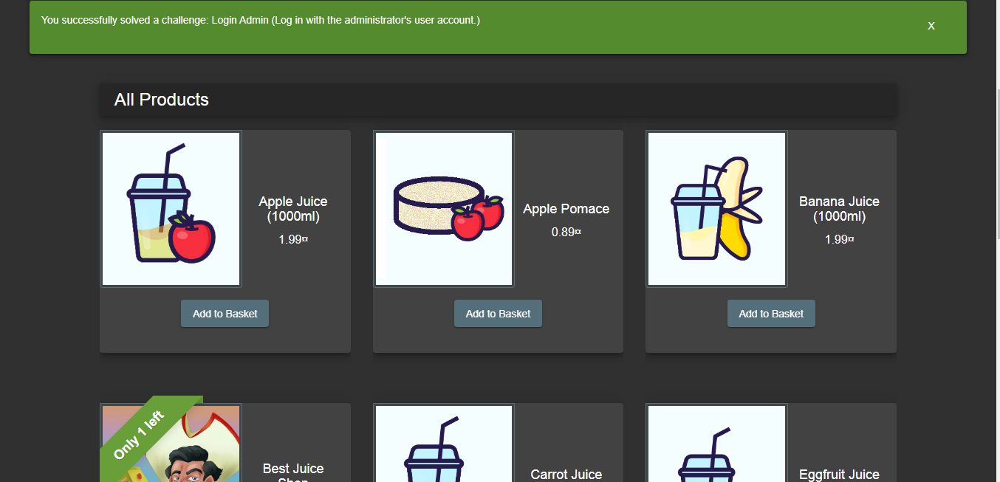
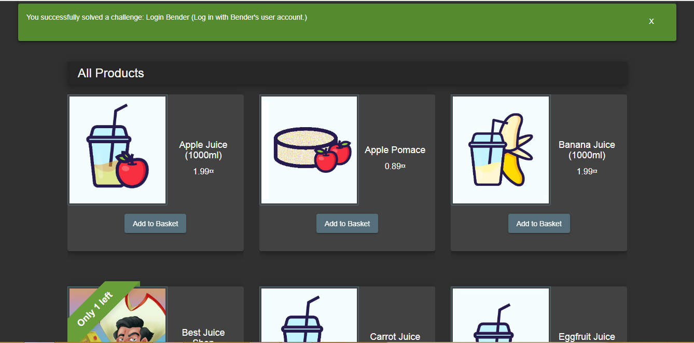
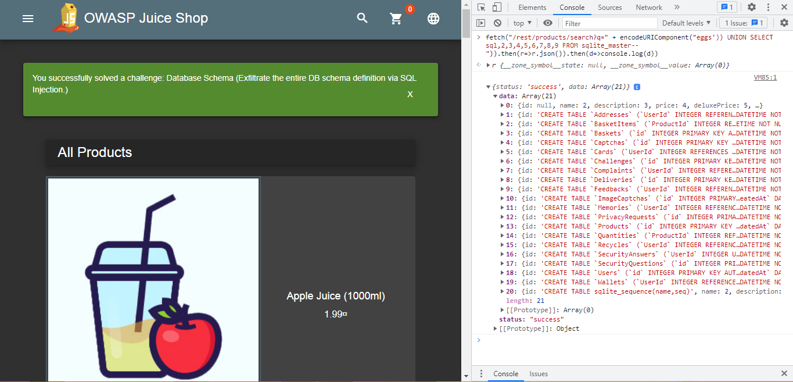

= Injection
include::../attributes.adoc[]

== Overview

Injection flaws occur when untrusted input is passed to an interpreter, such as a SQL database, as part of a command or query, without proper validation or escaping. This lets an attacker alter the intended logic of the query itself. Three Injection challenges were solved against the OWASP Juice Shop application, all stemming from the same root weakness in how the backend builds SQL queries.

== Login Admin (*)

=== Steps to Reproduce

1. Navigate to /#/login.
2. Enter ' OR 1=1-- as the email.
3. Enter any password.
4. Click "Log in". The app authenticates as the first user in the Users table, the administrator, with no valid password supplied.

=== Root Cause

The login query concatenates raw user input directly into a SQL string instead of using parameterized queries. The payload closes the email string early with ', injects OR 1=1, a condition that is always true, and uses -- to comment out the remainder of the original query, including the password check entirely. The query essentially becomes "return any user," rather than "return the user matching this email and password."

=== Impact

Complete authentication bypass with no credentials required. Because the query returns the first matching row, this specifically grants administrator access, the most damaging outcome possible from a login flaw.

=== Remediation

* Use parameterized queries or an ORM's safe query builder (e.g. Sequelize's findOne with a where object) rather than string concatenation.
* Validate and type-check input before it reaches the query layer.
* Reference: OWASP SQL Injection Prevention Cheat Sheet.

== Login Bender (**)

=== Steps to Reproduce

1. Navigate to /#/login.
2. Enter bender@juice-sh.op'-- as the email.
3. Enter any password.
4. Click "Log in". The app logs in as Bender without his real password.

=== Root Cause

Same underlying flaw as Login Admin, but targeted: by supplying a known valid email followed by '--, the attacker comments out the password check for that specific account rather than relying on the first row returned. This shows the vulnerability isn't just an "admin bypass trick", it's a general authentication bypass that works against any account once its email is known.

=== Impact

Any user account can be taken over if its email address is known or guessed, not just the admin's. This turns a single injection flaw into a mass account-takeover risk across the whole user base.

=== Remediation

* Same fix as above: parameterized queries everywhere user input touches SQL.
* Add anomaly detection on login attempts containing SQL metacharacters (', --, ;) to catch exploitation attempts in progress.

== Database Schema (*)

=== Steps to Reproduce

1. Open DevTools Console (F12).
2. Run:
+
[source,javascript]
----
fetch("/rest/products/search?q=" + encodeURIComponent("eggs')) UNION SELECT sql,2,3,4,5,6,7,8,9 FROM sqlite_master--"))
  .then(r => r.json())
  .then(d => console.log(d));
----
3. Expand the returned object. The data array contains full CREATE TABLE statements for the application's database.

=== Root Cause

The /rest/products/search endpoint builds its SQL query the same unsafe way as the login form, allowing a UNION SELECT to pull data from an entirely different table, sqlite_master, SQLite's own schema metadata, instead of just products. This confirms the injection flaw isn't isolated to authentication; it's a pattern repeated across the backend wherever user input reaches the database.

=== Impact

Exposing the full schema hands an attacker a map of every table and column in the application, including ones that store credentials or personal data. It turns one SQL injection point into a reconnaissance tool for planning further, more targeted attacks.

=== Remediation

* Parameterize all query endpoints, not just login, this flaw pattern needs a sweep across the codebase, not a single patch.
* Restrict the database user's permissions so it cannot query system tables like sqlite_master.
* Disable verbose query errors in production so failed injection attempts don't leak column counts or types during exploitation attempts.

== Testing Notes

During testing, a lone ' sent to /rest/products/search returned a normal 200 OK with no error, while the same character sent to the login endpoint triggered a 500 SQL error. This inconsistency suggests input handling isn't uniform across endpoints, some queries may already have partial safeguards (or simply tolerate the character in context), while others, like login, fail outright. This gap is worth flagging separately, since it means a blanket "it's all vulnerable" or "it's all safe" assumption would both be wrong.